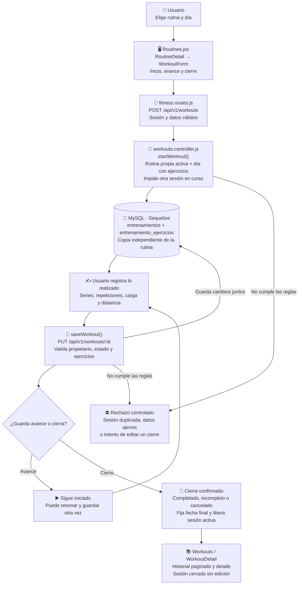

# Iván Lerner: Entrenamientos e historial de sesiones

Guía del **GYM-OS completo**. Reparto por funcionalidades para estudiar y revisar; no acredita autoría ni cambios que todavía no realizó cada integrante.

## Mapa visual para ubicarte

La prescripción de la rutina se copia a una sesión independiente. Desde ese momento guardás lo realizado y el cierre conserva el registro histórico.

Guardar avance mantiene iniciado. Completar, dejar incompleto o cancelar cierra la sesión y libera el lugar para otra; el historial cerrado no se modifica.

## Tu funcionalidad completa

La sesión deportiva real: iniciar una rutina por día, guardar avances, marcar ejercicios realizados, registrar cargas/distancia, completar o cancelar y consultar el historial. Aunque corresponde a un solo CU, es un módulo completo con estados y datos propios.

**Casos de uso:** CU021. **Pantallas:** `/entrenamientos y /entrenamientos/:id; inicio desde una rutina`.

## Archivos que tenés que abrir

- [client/src/pages/Routines.jsx](../client/src/pages/Routines.jsx)
- [controllers/workouts.controller.js](../controllers/workouts.controller.js)
- [models/Entrenamiento.model.js](../models/Entrenamiento.model.js)
- [models/EntrenamientoEjercicio.model.js](../models/EntrenamientoEjercicio.model.js)
- [routes/fitness.routes.js](../routes/fitness.routes.js)
- [shared/schemas.js](../shared/schemas.js)

## Librerías y herramientas de tu módulo

React maneja la sesión editable y las confirmaciones; React Router abre el detalle. Zod valida startWorkoutSchema y workoutSchema. Sequelize hace copias de los ejercicios y guarda cabecera/detalle dentro de la transacción común. Las fechas del usuario se calculan con Luxon en el dominio compartido.

## Funciones y componentes: qué hace cada uno

| Dónde ubicarlo                                                                                     | Qué recibe, hace y devuelve                                                                                                                                                                  |
| -------------------------------------------------------------------------------------------------- | -------------------------------------------------------------------------------------------------------------------------------------------------------------------------------------------- |
| [Workouts](../client/src/pages/Routines.jsx#L604) en `client/src/pages/Routines.jsx`               | Consulta el historial paginado y ofrece retomar/abrir sesiones.                                                                                                                              |
| [WorkoutDetail](../client/src/pages/Routines.jsx#L650) en `client/src/pages/Routines.jsx`          | Carga la sesión identificada en la URL y monta su formulario.                                                                                                                                |
| [WorkoutForm](../client/src/pages/Routines.jsx#L655) en `client/src/pages/Routines.jsx`            | Guarda el estado local de ejercicios. edit cambia un valor; save arma únicamente campos permitidos y envía PUT. Las acciones finales piden confirmación.                                     |
| [workoutDetail](../controllers/workouts.controller.js#L18) en `controllers/workouts.controller.js` | Exige propietario y devuelve sesión, nombre de rutina y snapshot de ejercicios.                                                                                                              |
| [getWorkout](../controllers/workouts.controller.js#L31) en `controllers/workouts.controller.js`    | Autoriza y verifica integridad antes de consultar el detalle.                                                                                                                                |
| [listWorkouts](../controllers/workouts.controller.js#L33) en `controllers/workouts.controller.js`  | Pagina sesiones del usuario por inicio e incluye sus ejercicios.                                                                                                                             |
| [startWorkout](../controllers/workouts.controller.js#L46) en `controllers/workouts.controller.js`  | Impide dos sesiones iniciadas; exige rutina propia activa y ejercicios para el día. Crea cabecera y copia ejercicios, con nueva identidad.                                                   |
| [saveWorkout](../controllers/workouts.controller.js#L154) en `controllers/workouts.controller.js`  | Ejecuta RegistroEntrenamiento.actualizarRegistro. Sólo acepta sesión iniciada; comprueba IDs exactos, series/repeticiones y consistencia del estado. Actualiza ejercicios y cabecera juntos. |

Los enlaces señalan el inicio de la función en la versión revisada. Estudiá su responsabilidad y su llamada anterior/siguiente; no hace falta memorizar cada instrucción. Los sufijos Impl contienen la implementación delegada por los métodos literales UML.

## Datos que guarda y consulta

entrenamientos guarda usuario, rutina, fecha, día, inicio/fin, estado y distancia. usuario_en_curso es una clave interna única que impide duplicar sesión activa. entrenamiento_ejercicios conserva nombre, orden, series, repeticiones, carga utilizada y realizado; no depende de que el ejercicio original siga igual.

## Endpoints para defenderlo

Todas estas rutas usan el prefijo `/api/v1`. Las mutaciones del navegador envían `X-GymOS-Client: web` y el origen configurado; las privadas requieren cookie válida.

| Método  | Ruta            | Resultado o condición                            |
| ------- | --------------- | ------------------------------------------------ |
| POST    | `/workouts`     | rutina_id y dia_semana; devuelve snapshot creado |
| GET     | `/workouts`     | Historial paginado                               |
| GET/PUT | `/workouts/:id` | Consultar o guardar sesión propia                |

## Recorrido que tenés que explicar sin leer

Desde detalle de rutina se elige un día -> startWorkout copia su prescripción -> el usuario registra valores reales -> Guardar avance conserva estado iniciado -> Finalizar exige ejercicios y confirma -> se fija fecha_fin y libera usuario_en_curso -> el historial queda de sólo lectura.

## Reglas y errores que no podés omitir

- Completado exige todos los ejercicios realizados; incompleto exige al menos uno; cancelado permite abandonar sin declarar realización.
- No se pueden enviar IDs de ejercicios de otra sesión ni omitir parte del conjunto.
- Una sesión finalizada no se modifica, ni siquiera enviando el mismo estado con otras cargas. Esta restricción fue corregida en la revisión.
- El día de la rutina puede ser lunes aunque hoy sea domingo: es una selección de plan; la fecha real se registra aparte.

Los errores de validación usan 400; falta de sesión 401; permiso/consentimiento 403; registro ajeno o ausente 404; conflicto de estado 409; límite de intentos 429; dependencia o integridad no disponible 503. No todo tu módulo produce todos estos códigos: identificá los de cada recorrido.

## Demostración con datos ficticios

1. Iniciar una rutina con dos ejercicios y comprobar que la segunda sesión activa se rechaza.
2. Guardar un ejercicio y recargar para retomar el avance.
3. Terminar incompleto o marcar ambos y completar con confirmación.
4. Mostrar campos deshabilitados al abrir el historial.
5. Editar la rutina después y comprobar que el registro anterior conserva sus ejercicios.

## Preguntas con respuesta

**¿Por qué copiar los ejercicios?** Para conservar lo realizado aunque el plan cambie.

**¿Cómo se evita reabrir por un POST/PUT manual?** El controlador exige estado iniciado; deshabilitar botones no es suficiente.

**¿Qué cambia incompleto frente a cancelado?** Incompleto declara trabajo parcial; cancelado conserva la sesión abandonada sin contarla como completa.

## Límite con los otros integrantes

Joaquín proporciona la rutina y el catálogo; Gade usa las sesiones completadas en progreso/panel; Paulo utiliza distancia o frecuencia en ciertos objetivos. Tu módulo no decide los porcentajes de objetivo.

## Preparación para exponer

Podés presentar tu bloque así: «Mi funcionalidad es entrenamientos e historial de sesiones. Voy a mostrar qué puede hacer el usuario, seguir una operación desde el formulario hasta MySQL y explicar qué ocurre si los datos o permisos no son válidos». Adaptalo a lo que realmente revisaste.

Estás preparado cuando podés demostrar el recorrido feliz, un rechazo, una cancelación donde exista y la persistencia después de recargar. Si falla un proveedor externo, explicá la alternativa real y no inventes una respuesta exitosa.

Antes de exponer, leé el [recorrido común](README.md) y el [informe de revisión](../docs/REVISION-FINAL.md). Anotá las comprobaciones y cambios reales en [REPARTO.md](../REPARTO.md).
