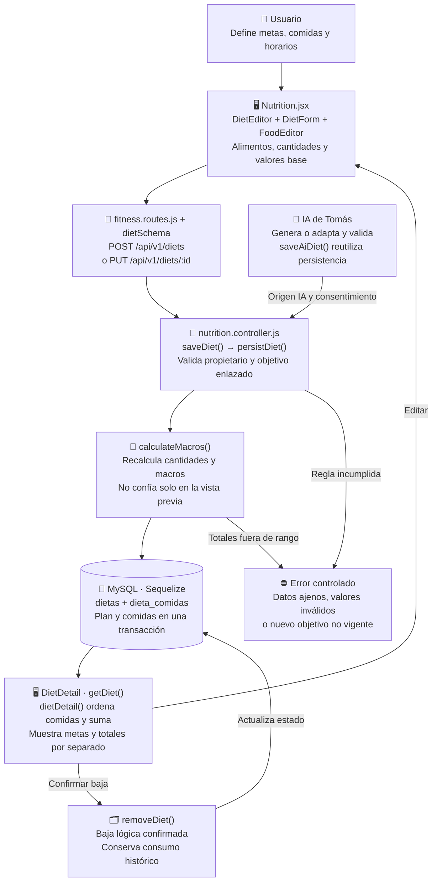

# Valentín Schueld: Dietas y planificación alimentaria

Guía del **GYM-OS completo**. Reparto por funcionalidades para estudiar y revisar; no acredita autoría ni cambios que todavía no realizó cada integrante.

## Mapa visual para ubicarte

Una dieta es un plan de comidas. Guardarla define lo previsto; registrar que alguien comió pasa al módulo de Mateo.

Una meta calórica y la suma de alimentos planificados son valores distintos. Una dieta guardada no genera automáticamente filas de comidas_consumidas.

## Tu funcionalidad completa

El plan de alimentación: comidas por horario, alimentos y cantidades, objetivos nutricionales, detalle, edición y baja. Planificar una dieta es una funcionalidad distinta de registrar lo que efectivamente se comió.

**Casos de uso:** CU022, CU024, CU025, CU027 y CU028; generación/adaptación IA con Tomás. **Pantallas:** `/dietas, /dietas/nueva, /dietas/:id y /dietas/:id/editar`.

## Archivos que tenés que abrir

- [client/src/pages/Nutrition.jsx](../client/src/pages/Nutrition.jsx)
- [controllers/nutrition.controller.js](../controllers/nutrition.controller.js)
- [models/Dieta.model.js](../models/Dieta.model.js)
- [models/DietaComida.model.js](../models/DietaComida.model.js)
- [shared/schemas.js](../shared/schemas.js)
- [routes/fitness.routes.js](../routes/fitness.routes.js)

## Librerías y herramientas de tu módulo

React y React Router construyen lista, editor y detalle; Zod valida dietSchema/mealSchema/foodSchema. Sequelize persiste cabecera y comidas. FoodEditor es compartido con consumo: no es otra base ni un proveedor IA. Los cálculos se vuelven a realizar en el servidor.

## Funciones y componentes: qué hace cada uno

| Dónde ubicarlo                                                                                         | Qué recibe, hace y devuelve                                                                                                                                            |
| ------------------------------------------------------------------------------------------------------ | ---------------------------------------------------------------------------------------------------------------------------------------------------------------------- |
| [Diets](../client/src/pages/Nutrition.jsx#L506) en `client/src/pages/Nutrition.jsx`                    | Lista planes y permite crear o ir a generación IA.                                                                                                                     |
| [DietEditor](../client/src/pages/Nutrition.jsx#L561) en `client/src/pages/Nutrition.jsx`               | Carga un plan según id o uno nuevo. La key reinicia DietForm al cambiar de plan para no reutilizar otro formulario.                                                    |
| [DietForm](../client/src/pages/Nutrition.jsx#L570) en `client/src/pages/Nutrition.jsx`                 | Administra nombre, objetivo, metas y comidas. update cambia una comida; el envío convierte metas a números y hace POST/PUT antes de navegar al detalle.                |
| [FoodEditor](../client/src/pages/Nutrition.jsx#L135) en `client/src/pages/Nutrition.jsx`               | Edita alimentos y cantidades para cada comida; usa búsqueda opcional y cálculo orientativo de vista previa.                                                            |
| [DietDetail](../client/src/pages/Nutrition.jsx#L751) en `client/src/pages/Nutrition.jsx`               | Muestra metas separadas de totales planificados, comidas/horarios y confirmación de baja.                                                                              |
| [dietDetail](../controllers/nutrition.controller.js#L46) en `controllers/nutrition.controller.js`      | Exige plan propio no eliminado, ordena comidas y suma macros planificados. Devuelve metas y totales como datos diferentes.                                             |
| [getDiet](../controllers/nutrition.controller.js#L63) en `controllers/nutrition.controller.js`         | Consulta un plan con autorización e integridad.                                                                                                                        |
| [listDiets](../controllers/nutrition.controller.js#L65) en `controllers/nutrition.controller.js`       | Lista planes no eliminados con sus comidas.                                                                                                                            |
| [persistDiet](../controllers/nutrition.controller.js#L76) en `controllers/nutrition.controller.js`     | Calcula macros de alimentos, crea/actualiza cabecera y reemplaza comidas en una transacción. Mantiene un vínculo histórico sin exigir objetivo activo si no se cambia. |
| [saveDiet](../controllers/nutrition.controller.js#L132) en `controllers/nutrition.controller.js`       | Ejecuta Dieta.actualizarDieta y registra crear o modificar manualmente.                                                                                                |
| [saveAiDiet](../controllers/nutrition.controller.js#L134) en `controllers/nutrition.controller.js`     | Reutiliza persistencia con origen ia; también se verifica consentimiento vigente antes de confirmar.                                                                   |
| [removeDiet](../controllers/nutrition.controller.js#L138) en `controllers/nutrition.controller.js`     | Ejecuta Dieta.eliminarDieta; hace baja lógica sin borrar consumo histórico.                                                                                            |
| [calculateMacros](../controllers/nutrition.controller.js#L38) en `controllers/nutrition.controller.js` | Suma cada alimento con su factor de cantidad; g/ml usa base 100 y porción base 1. Rechaza totales fuera de rango.                                                      |

Los enlaces señalan el inicio de la función en la versión revisada. Estudiá su responsabilidad y su llamada anterior/siguiente; no hace falta memorizar cada instrucción. Los sufijos Impl contienen la implementación delegada por los métodos literales UML.

## Datos que guarda y consulta

dietas contiene propietario, objetivo opcional, metas diarias, origen, estado y fechas. dieta_comidas contiene horario, tipo, nombre, lista JSON de alimentos y macros calculados. No hay módulo independiente de recetas: una comida puede tener varios alimentos, pero no inventar una funcionalidad ausente para dividir al equipo.

## Endpoints para defenderlo

Todas estas rutas usan el prefijo `/api/v1`. Las mutaciones del navegador envían `X-GymOS-Client: web` y el origen configurado; las privadas requieren cookie válida.

| Método         | Ruta                                       | Resultado o condición                |
| -------------- | ------------------------------------------ | ------------------------------------ |
| GET/POST       | `/diets`                                   | Listar y crear                       |
| GET/PUT/DELETE | `/diets/:id`                               | Consultar, reemplazar y dar de baja  |
| POST           | `/ai/diets/generate o /ai/diets/:id/adapt` | Operaciones IA coordinadas con Tomás |

## Recorrido que tenés que explicar sin leer

El usuario define metas y comidas -> FoodEditor reúne valores base y cantidades -> dietSchema valida -> persistDiet recalcula macros -> guarda plan/comidas juntos -> el detalle muestra diferencia entre metas y suma de alimentos. Ninguna de estas acciones crea un consumo real.

## Reglas y errores que no podés omitir

- Metas diarias y suma de comidas son conceptos separados; la aplicación no debe decir que se consumió algo por guardarlo en el plan.
- Al editar se reemplazan comidas dentro de una transacción; no queda medio plan si falla.
- Un objetivo completado no bloquea la edición del plan que ya estaba asociado; un vínculo nuevo sí exige objetivo activo.
- Borrar dieta es baja lógica y no borra el historial de comidas consumidas.

Los errores de validación usan 400; falta de sesión 401; permiso/consentimiento 403; registro ajeno o ausente 404; conflicto de estado 409; límite de intentos 429; dependencia o integridad no disponible 503. No todo tu módulo produce todos estos códigos: identificá los de cada recorrido.

## Demostración con datos ficticios

1. Crear un plan con desayuno y cena, horario y dos alimentos.
2. Mostrar que 50 g de alimento con 400 kcal/100 g aporta 200 kcal.
3. Comparar metas con totales del plan.
4. Editar una comida y recargar.
5. Consultar Nutrición y demostrar que todavía no se registró consumo por crear una dieta.

## Preguntas con respuesta

**¿Una dieta es lo que comí?** No; es planificación. El consumo real se guarda aparte.

**¿Por qué guardar macros calculados por servidor?** Para no confiar en una suma manipulada desde el navegador.

**¿Cuántas recetas tiene el sistema?** No hay entidad ni módulo de recetas independiente; hay comidas compuestas por alimentos.

## Límite con los otros integrantes

Mateo comparte FoodEditor y cálculo de macros, pero es dueño del consumo real y consulta de alimentos. Paulo ofrece objetivos; Tomás genera/adapta dietas; vos defendés el plan y su persistencia.

## Preparación para exponer

Podés presentar tu bloque así: «Mi funcionalidad es dietas y planificación alimentaria. Voy a mostrar qué puede hacer el usuario, seguir una operación desde el formulario hasta MySQL y explicar qué ocurre si los datos o permisos no son válidos». Adaptalo a lo que realmente revisaste.

Estás preparado cuando podés demostrar el recorrido feliz, un rechazo, una cancelación donde exista y la persistencia después de recargar. Si falla un proveedor externo, explicá la alternativa real y no inventes una respuesta exitosa.

Antes de exponer, leé el [recorrido común](README.md) y el [informe de revisión](../docs/REVISION-FINAL.md). Anotá las comprobaciones y cambios reales en [REPARTO.md](../REPARTO.md).
